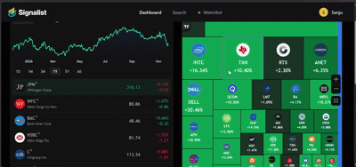

# 📈 Signalist — Stock Market Intelligence Platform

A modern stock market intelligence platform designed to help users explore financial markets, track stocks, and analyze market trends through an interactive and intuitive interface.

🌐 **Live Demo:** [View Signalist](https://signalist20-rdjuog6jq-sanjus-projects-951a3a1e.vercel.app/)

## 🎥 Project Demo



## ✨ Features

- 📊 Interactive stock market dashboard
- 📈 Stock price tracking and market insights
- 🔍 Stock search and exploration
- 📉 Financial data visualization
- 🎨 Modern and responsive user interface
- ⚡ Optimized performance and smooth navigation

## 🛠️ Tech Stack

- **Framework:** Next.js
- **Language:** TypeScript
- **Styling:** Tailwind CSS
- **Deployment:** Vercel

## 🚀 Getting Started

### Prerequisites

- Node.js
- npm

### Installation

```bash
git clone https://github.com/SanjuRohilla/signalist.git

cd signalist

npm install

npm run dev
```

Open http://localhost:3000 in your browser.

## 🌐 Live Deployment

[Signalist — Live Application](https://signalist20-rdjuog6jq-sanjus-projects-951a3a1e.vercel.app/)

## 👩‍💻 Author

**Sanju Rohilla**

- GitHub: [@SanjuRohilla](https://github.com/SanjuRohilla)

---

⭐ If you like this project, consider giving it a star!
